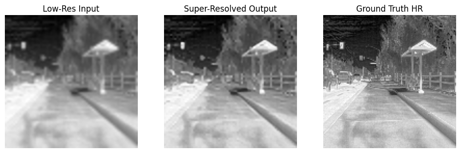
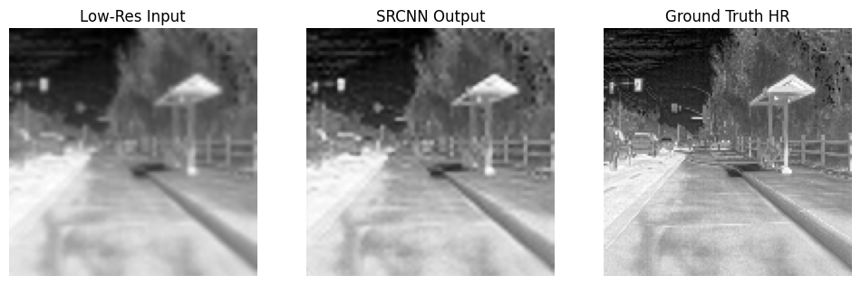
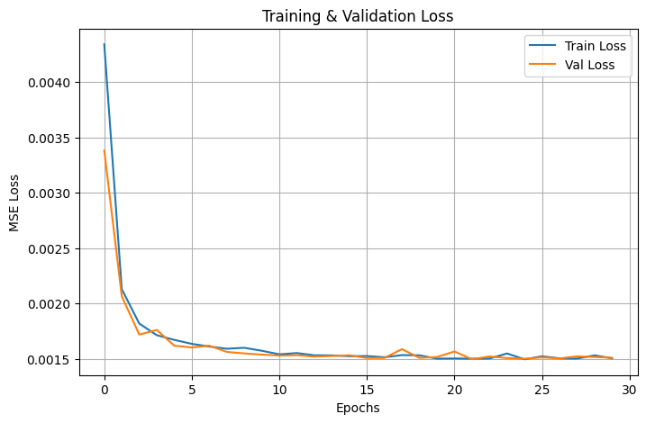

# Lightweight CNN Autoencoder for Thermal Image Super-Resolution (128×128)


Two very small convolutional models that restore detail in 128×128 grayscale thermal (LWIR) images. The goal is a model light enough to run on low-power hardware.

This folder is one part of the [Thermal Image Super-Resolution project](../README.md).

## Results

Both models were tested on the same 1,564 test images. PSNR and SSIM are calculated for each image and then averaged.

| Model | Parameters | Model size | Avg. PSNR | Avg. SSIM | File |
|-------|-----------:|-----------:|----------:|----------:|------|
| Autoencoder (AE) | 37,569 | 146.75 KB | 29.14 dB | 0.8191 | `SRTFLIRADASAE.h5` |
| SRCNN | 8,129 | 31.75 KB | 28.87 dB | 0.8087 | `best_srcnn_model.h5` |

The autoencoder scores a little higher (+0.27 dB PSNR, +0.0104 SSIM) but has about 4.6 times more parameters. The SRCNN gets close with a much smaller model. The 128×128 numbers in the [project README](../README.md) (PSNR 28.87, SSIM 0.8087) are the SRCNN numbers.

### Example output

This is the first image in the test set, not a hand-picked one. Each picture shows the low-quality input, the model output, and the ground truth, from left to right.

**Autoencoder** (PSNR 26.29, SSIM 0.7803)



**SRCNN** (PSNR 26.12, SSIM 0.7716)



The outputs are sharper than the input, but fine detail is still missing when you compare them with the ground truth.

## Dataset

- **Source:** FLIR ADAS thermal images (LWIR), read as grayscale.
- **Split:** 14,071 training images, split 80/20 into 11,256 for training and 2,815 for validation (`random_state=42`). A separate set of 1,564 images is used for testing.
- **Not included:** the dataset is not stored in this repository. The notebook reads it from an archive named `FLIR_ADAS_Thermal_SR.7z` with `train/` and `test/` folders.

## How the data is prepared

1. Read each image as grayscale, resize it to 128×128, and scale the pixel values to the range 0 to 1.
2. Make the low-quality input: shrink the image by a factor of 2 (to 64×64), then resize it back to 128×128.
3. Use the original 128×128 image as the target.

So the input and the output have the same size. The models learn to restore detail that was lost when the image was shrunk and resized back.

## Models

| | Autoencoder | SRCNN |
|---|---|---|
| Layers | Conv 32 (3×3) → MaxPool 2×2 → Conv 64 (3×3) → UpSample 2×2 → Conv 32 (3×3) → Conv 1 (3×3) | Conv 64 (9×9) → Conv 32 (1×1) → Conv 1 (5×5) |
| Activations | ReLU, last layer sigmoid | ReLU, last layer sigmoid |
| Parameters | 37,569 | 8,129 |
| Saved weights | After the last epoch | Epoch with the lowest validation loss |

Training settings for both: Adam optimizer, mean squared error (MSE) loss, batch size 16, 30 epochs.

The SRCNN used a model checkpoint on validation loss. Its best value was 0.00149 at epoch 22.



## What is in this folder

| File | Description |
|------|-------------|
| `SRT LW LWIR AE CNN 128X128.ipynb` | Notebook with data loading, both models, training and evaluation |
| `SRTFLIRADASAE.h5` | Trained autoencoder |
| `best_srcnn_model.h5` | Best SRCNN checkpoint |
| `figures/` | Images used in this README |

The `.h5` files also hold the optimizer state, so they are larger than the model sizes in the table above.

## Quick start

### Requirements

```bash
pip install tensorflow opencv-python numpy matplotlib scikit-learn scikit-image
```

The notebook was run on Google Colab. The models were saved with Keras 3.8 (TensorFlow backend).

### Use a trained model

```python
import cv2
from tensorflow.keras.models import load_model

model = load_model("SRTFLIRADASAE.h5", compile=False)  # or "best_srcnn_model.h5"

# A 128x128 grayscale image, scaled to the range 0 to 1
img = cv2.imread("thermal.png", cv2.IMREAD_GRAYSCALE)
img = cv2.resize(img, (128, 128)) / 255.0

x = img[None, ..., None].astype("float32")  # shape (1, 128, 128, 1)
restored = model.predict(x)[0, ..., 0]      # values between 0 and 1
```

To repeat the test used in this project, first shrink the image to 64×64 and resize it back to 128×128, as described in the data preparation section.

### Train again

1. Open the notebook in Google Colab and mount Google Drive.
2. Put `FLIR_ADAS_Thermal_SR.7z` in `MyDrive/model/`, or change `archive_path` in the first cell.
3. Run all cells. The notebook extracts the data, trains both models, and prints PSNR and SSIM for the test set.

## Limitations

- **The image does not get bigger.** Input and output are both 128×128. The models restore a blurred image. They do not create a larger one.
- **No baseline in the notebook.** The notebook does not report PSNR and SSIM for the low-quality input itself, which is the natural baseline. So the gain over simple resizing is not measured here.
- **Simulated low quality.** The test inputs are made by shrinking and resizing. Images from a real low-resolution thermal camera may behave differently.
- **One training run.** Results come from a single run, without repeated seeds.
- **Not comparable across sizes.** The 256×256 results in the project README use a different image size, so they cannot be compared with these numbers directly.

## Next steps

- Add the baseline PSNR and SSIM of the low-quality input to the notebook.
- Convert the models to TensorFlow Lite and measure speed on the target device.

## Related

- [Project overview](../README.md)
- [256×256 SRCNN pipeline with YOLOv8](../SRCNN%20WITH%20PIPELINE%20FLIR%20THERMAL%20ONLY%20WITH%20YOLOV8/)

## Author

**Mohammad Haris Mushtaq**, BS Artificial Intelligence, NUTECH Islamabad

[LinkedIn](https://www.linkedin.com/in/mohammad-haris-mushtaq-b95001286/) · [GitHub](https://github.com/Harismushtaq12)

## License

Apache License 2.0. See [LICENSE](../../LICENSE).
